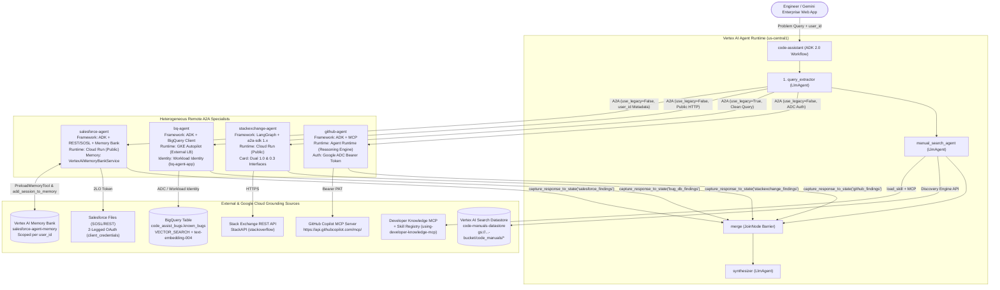
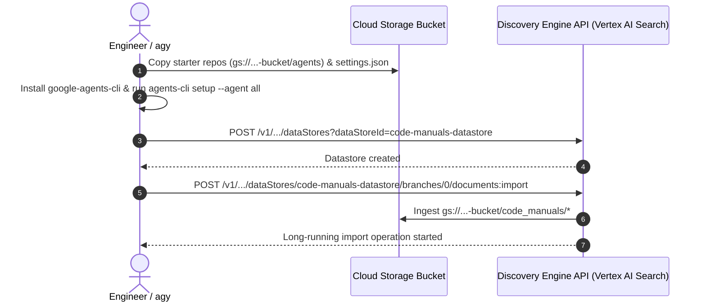
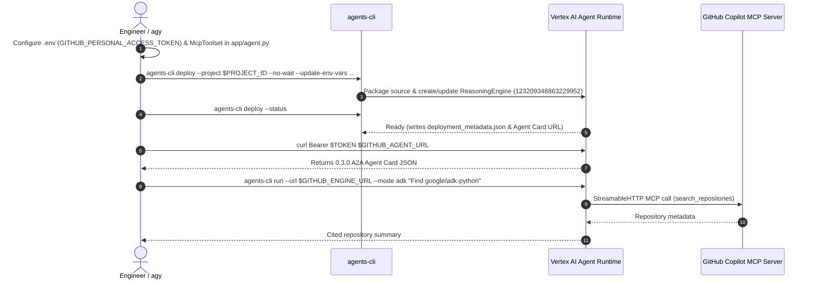
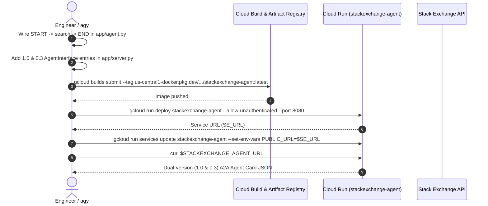
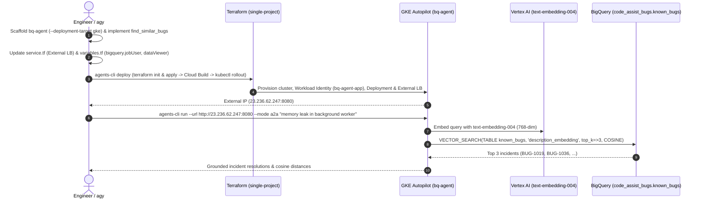
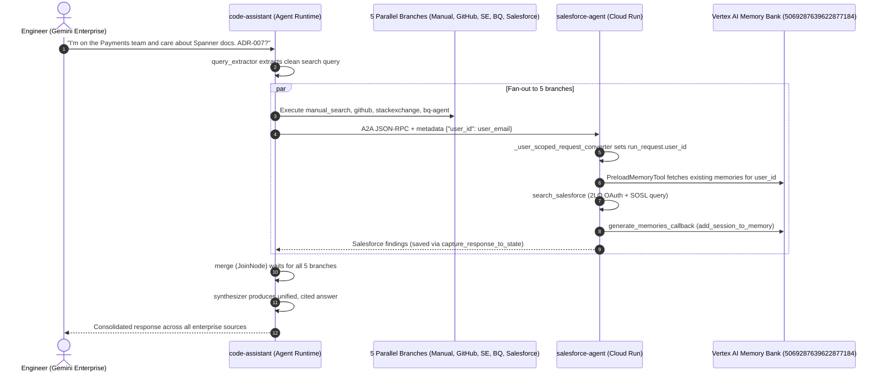

# Heterogeneous Multi-Agent System over A2A ("Code Assist") — Step-by-Step Runbook, HLD, LLD & Workflows

- **Lab URL**: `https://explore.qwiklabs.com/classrooms/21504/labs/115873`
- **Project ID**: `qwiklabs-gcp-01-da944a54194d` (Project Number: `306082515579`)
- **Primary Region**: `us-central1` (Vertex AI Model Location: `global`)
- **Default Model**: `gemini-3.5-flash` (Embeddings: `text-embedding-004`, 768 dimensions)
- **Tooling**: Google Agent Development Kit (`google-adk` 2.0), `google-agents-cli` (`v1.12.0`), LangGraph, `a2a-sdk`, Terraform (`v1.11.4`), Antigravity (`agy`)

---

## 1. High-Level Design (HLD)

### 1.1 System Architecture Overview

**Code Assist** is an enterprise production-incident research system composed of five specialist agents and one root orchestrator (`code-assistant`). The specialists are deliberately heterogeneous across **agent frameworks** (ADK 2.0, LangGraph) and **Google Cloud runtimes** (Vertex AI Agent Runtime, Cloud Run, GKE Autopilot), interoperating over the **Agent2Agent (A2A)** protocol.



### 1.2 Specialist & Runtime Matrix

| Specialist / Node | Framework | Compute Runtime | A2A Card Path | A2A Mode (`use_legacy`) | Inbound Auth Model | Downstream Backing Service |
| :--- | :--- | :--- | :--- | :--- | :--- | :--- |
| **`github-agent`** | ADK (`Agent` + `McpToolset`) | Vertex AI Agent Runtime (`ReasoningEngine`) | `/api/a2a/app/.well-known/agent-card.json` | `False` (ADK Extension) | OAuth2 Bearer Token (`GoogleADCAuth`) + `roles/aiplatform.user` | Hosted GitHub MCP Server (`https://api.githubcopilot.com/mcp/`) |
| **`stackexchange-agent`** | LangGraph (`StateGraph`) + `a2a-sdk` 1.x | Cloud Run (`--allow-unauthenticated`) | `/.well-known/agent-card.json` | `True` (Standard 0.3 JSON-RPC) | Public (`allUsers`) | Stack Exchange API (`stackapi`) |
| **`bq-agent`** | ADK (`Agent` + `find_similar_bugs`) | GKE Autopilot (`LoadBalancer` port `8080`) | `/a2a/app/.well-known/agent-card.json` | `False` (ADK Extension) | Public External LoadBalancer | Vertex AI Embeddings (`text-embedding-004`) + BigQuery `VECTOR_SEARCH` |
| **`manual_search_agent`** | Local ADK `LlmAgent` inside `code-assistant` | Vertex AI Agent Runtime (in-process) | N/A (In-process graph node) | N/A | Runtime SA (`service-<PROJECT_NUM>@gcp-sa-aiplatform-re...`) | Vertex AI Search (`code-manuals-datastore`) + Skill Registry + Developer Knowledge MCP |
| **`salesforce-agent`** | ADK (`Agent` + `PreloadMemoryTool`) | Cloud Run (`allUsers` `roles/run.invoker`) | `/a2a/app/.well-known/agent-card.json` | `False` (ADK Extension + `user_id` metadata) | Public (`allUsers`) | Salesforce REST/SOSL API (2LO) + Vertex AI Memory Bank |
| **`code-assistant` (Root)** | ADK 2.0 `Workflow` (`JoinNode` fan-in) | Vertex AI Agent Runtime + Gemini Enterprise | `/api/a2a/app/.well-known/agent-card.json` | Root Orchestrator | Google Identity / Vertex AI IAM | Orchestrates all 5 branches in parallel |

---

## 2. Low-Level Design (LLD)

### 2.1 Component-Level Implementation Specifications

#### 2.1.1 Task 1 — Vertex AI Search Datastore (`code-manuals-datastore`)
- **Collection**: `projects/${PROJECT_ID}/locations/global/collections/default_collection`
- **DataStore ID**: `code-manuals-datastore` (`industryVertical: GENERIC`, `solutionTypes: ["SOLUTION_TYPE_SEARCH"]`, `contentConfig: CONTENT_REQUIRED`)
- **Ingestion Source**: `gs://${PROJECT_ID}-bucket/code_manuals/*` (`dataSchema: "content"`, `reconciliationMode: "INCREMENTAL"`)

#### 2.1.2 Task 2 — `github-agent` (`~/agents/github-agent/app/agent.py`)
- **MCP Toolset Wiring**:
  ```python
  github_mcp_toolset = McpToolset(
      connection_params=StreamableHTTPConnectionParams(
          url=GITHUB_MCP_URL,
          headers={"Authorization": f"Bearer {GITHUB_TOKEN}"},
      ),
      tool_filter=GITHUB_TOOL_FILTER,
  )
  ```
- **Tool Filter (`GITHUB_TOOL_FILTER`)**: Restricted to read-only GitHub tools (`search_repositories`, `search_issues`, `list_issues`, `get_issue`, `get_issue_comments`, `list_pull_requests`, `search_pull_requests`, `pull_request_read`) to minimize latency and prevent write operations.

#### 2.1.3 Task 3 — `stackexchange-agent` (`~/agents/stackexchange-agent/`)
- **LangGraph Workflow (`app/agent.py`)**:
  - Deterministic graph (`StateGraph(State)`) with no LLM calls:
    ```python
    workflow = StateGraph(State)
    workflow.add_node("search", search)
    workflow.add_edge(START, "search")
    workflow.add_edge("search", END)
    ```
- **Dual-Version A2A Card (`app/server.py`)**:
  - `a2a-sdk` 1.x moves interface URLs into `supported_interfaces`, whereas the ADK A2A client expects `0.3` compatibility. Advertising both `1.0` and `0.3` `AgentInterface` entries on `rpc_url = f"{PUBLIC_URL}/a2a/jsonrpc"` with `enable_v0_3_compat=True` bridges the protocol version gap:
    ```python
    supported_interfaces=[
        AgentInterface(url=rpc_url, protocol_binding="JSONRPC", protocol_version="1.0"),
        AgentInterface(url=rpc_url, protocol_binding="JSONRPC", protocol_version="0.3"),
    ]
    ```

#### 2.1.4 Task 4 — `bq-agent` (`~/agents/bq-agent/`)
- **Project Scaffolding**:
  - Generated via `agents-cli scaffold create bq-agent --agent adk_python --deployment-target gke --region us-central1 --cicd-runner skip --session-type in_memory --auto-approve`.
- **Semantic Vector Search Tool (`app/agent.py` -> `find_similar_bugs(query: str) -> str`)**:
  1. Embeds `query` using `genai.Client(vertexai=True, project=project, location="us-central1")` with model `text-embedding-004` (768-dimensional `FLOAT64` vector matching the pre-populated table).
  2. Executes parameterized read-only BigQuery `VECTOR_SEARCH`:
     ```sql
     SELECT
       base.bug_id,
       base.title,
       base.description,
       base.resolution,
       distance
     FROM VECTOR_SEARCH(
       TABLE `qwiklabs-gcp-01-da944a54194d.code_assist_bugs.known_bugs`,
       'description_embedding',
       (SELECT @query_embedding AS embedding),
       query_column_to_search => 'embedding',
       top_k => 3,
       distance_type => 'COSINE'
     )
     ORDER BY distance ASC
     ```
  3. Formats matches with `bug_id`, `title`, `description`, `resolution`, and cosine `distance`, degrading gracefully without raising exceptions on empty or transient failures.
- **GKE Infrastructure (`deployment/terraform/single-project/`)**:
  - `service.tf`: Removed internal LoadBalancer annotation (`networking.gke.io/load-balancer-type = "Internal"`) so `kubernetes_service_v1.app` provisions an externally reachable TCP LoadBalancer IP on port `8080`, and injected `GOOGLE_GENAI_USE_VERTEXAI="True"` and `MODEL="gemini-3.5-flash"`.
  - `variables.tf`: Added `roles/bigquery.jobUser` and `roles/bigquery.dataViewer` to `app_sa_roles` for `bq-agent-app@${PROJECT_ID}.iam.gserviceaccount.com` bound via GKE Workload Identity (`roles/iam.workloadIdentityUser`).

#### 2.1.5 Task 5 & 6 — `code-assistant` Root Orchestrator (`~/agents/code-assistant/`)
- **State Capture Callback (`app/callbacks.py`)**:
  - `RemoteA2aAgent` emits content events rather than setting an `output_key`. `capture_response_to_state(state_key)` inspects `callback_context.session.events` in reverse order, finds the latest text reply authored by `callback_context.agent_name`, and writes it to `callback_context.state[state_key]`.
- **Google ADC HTTPX Auth (`app/auth.py`)**:
  - `GoogleADCAuth._apply(request)` refreshes default credentials via `self._creds.before_request(self._auth_request, request.method, str(request.url), headers)` and attaches the `Authorization: Bearer <token>` header for authenticated Agent Runtime calls (`github-agent`).
- **ADK 2.0 Graph Workflow (`app/agent.py`)**:
  ```python
  edges=[
      (START, query_extractor),
      (query_extractor, [
          manual_search_agent,
          github_agent,
          stackexchange_agent,
          salesforce_agent,
          bug_db_agent,
      ]),
      ([
          manual_search_agent,
          github_agent,
          stackexchange_agent,
          salesforce_agent,
          bug_db_agent,
      ], merge),
      (merge, synthesizer),
  ]
  ```

#### 2.1.6 Task 7 & 8 — `salesforce-agent` & Vertex AI Memory Bank (`~/agents/salesforce-agent/`)
- **2-Legged OAuth Client (`app/salesforce_client.py`)**:
  - `authenticate()` posts `{"grant_type": "client_credentials", "client_id": self.client_id, "client_secret": self.client_secret}` to `https://{self.domain}/services/oauth2/token` with `timeout=_TIMEOUT_SECONDS`.
- **End-to-End User ID Propagation Over A2A**:
  - **Root (`code-assistant/app/app_utils/a2a.py`)**: `user_id_meta_provider(ctx, _message)` injects `{"user_id": ctx.user_id}` into the outgoing A2A request metadata.
  - **Specialist (`salesforce-agent/app/app_utils/a2a.py`)**: `_user_scoped_request_converter(request, part_converter)` calls `convert_a2a_request_to_agent_run_request(request, part_converter=part_converter)` and overrides `run_request.user_id` with the forwarded metadata `user_id` so memories persist across separate conversations.
- **Memory Read/Write Lifecycle (`salesforce-agent/app/agent.py`)**:
  - **Read**: `PreloadMemoryTool()` in `root_agent.tools` preloads relevant user facts from `VertexAiMemoryBankService` before each turn.
  - **Write**: `generate_memories_callback` calls `await callback_context.add_session_to_memory()` as `after_agent_callback` to asynchronously extract and consolidate durable user facts.

---

## 3. Workflows for Each Lab Step

### 3.1 Task 1 Workflow — Environment & Vertex AI Search Datastore Setup


### 3.2 Task 2 Workflow — `github-agent` Deployment to Agent Runtime


### 3.3 Task 3 Workflow — `stackexchange-agent` (LangGraph) Deployment to Cloud Run


### 3.4 Task 4 Workflow — `bq-agent` Generation & GKE Autopilot Deployment


### 3.5 Tasks 5–8 Workflow — Root Orchestration, Salesforce Specialist & Memory Bank


---

## 4. Step-by-Step Execution Runbook (Commands Executed)

### Step 1: Environment Setup & Vertex AI Search Datastore (Task 1)

```bash
export PROJECT_ID=qwiklabs-gcp-01-da944a54194d
export REGION=us-central1
gcloud config set project ${PROJECT_ID}

# 1. Copy starter code and IDE settings from the lab bucket
gcloud storage cp -r gs://${PROJECT_ID}-bucket/agents ~/
mkdir -p ~/.vscode
gcloud storage cp -r gs://${PROJECT_ID}-bucket/settings.json ~/.vscode/

# 2. Install google-agents-cli and configure agent skills
export PATH="${HOME}/.local/bin:${PATH}"
uv tool install google-agents-cli
agents-cli info
agents-cli setup --agent all

# 3. Create the Vertex AI Search datastore (code-manuals-datastore)
curl -X POST \
  -H "Authorization: Bearer $(gcloud auth print-access-token)" \
  -H "Content-Type: application/json" \
  -H "X-Goog-User-Project: ${PROJECT_ID}" \
  "https://discoveryengine.googleapis.com/v1/projects/${PROJECT_ID}/locations/global/collections/default_collection/dataStores?dataStoreId=code-manuals-datastore" \
  -d '{"displayName":"Code manuals","industryVertical":"GENERIC","solutionTypes":["SOLUTION_TYPE_SEARCH"],"contentConfig":"CONTENT_REQUIRED"}'

# 4. Import manual documents from GCS into code-manuals-datastore
curl -X POST \
  -H "Authorization: Bearer $(gcloud auth print-access-token)" \
  -H "Content-Type: application/json" \
  "https://discoveryengine.googleapis.com/v1/projects/${PROJECT_ID}/locations/global/collections/default_collection/dataStores/code-manuals-datastore/branches/0/documents:import" \
  -d '{"reconciliationMode":"INCREMENTAL","gcsSource":{"inputUris":["gs://'${PROJECT_ID}'-bucket/code_manuals/*"],"dataSchema":"content"}}'
```

---

### Step 2: Configure & Deploy `github-agent` to Agent Runtime (Task 2)

```bash
cd ~/agents/github-agent

# 1. Create .env (replace <YOUR_GITHUB_PAT> with your classic PAT with repo, read:org scopes)
cat << 'EOF' > .env
GOOGLE_CLOUD_PROJECT=qwiklabs-gcp-01-da944a54194d
GOOGLE_CLOUD_LOCATION=global
GOOGLE_GENAI_USE_VERTEXAI=True
MODEL=gemini-3.5-flash
GITHUB_PERSONAL_ACCESS_TOKEN=<YOUR_GITHUB_PAT>
GITHUB_MCP_URL=https://api.githubcopilot.com/mcp/
EOF

# 2. Run unit tests to verify McpToolset configuration in app/agent.py
uv run pytest tests/unit

# 3. Deploy github-agent to Vertex AI Agent Runtime
agents-cli deploy --project ${PROJECT_ID} --no-confirm-project --no-wait \
  --update-env-vars "$(grep -v '^#' .env | grep -v '^$' | grep -v '^GOOGLE_CLOUD_PROJECT' | paste -sd,)"

# 4. Poll until deployment completes and writes deployment_metadata.json
agents-cli deploy --status

# 5. Export and persist GITHUB_AGENT_URL
export GITHUB_AGENT_URL="https://us-central1-aiplatform.googleapis.com/reasoningEngines/v1/projects/306082515579/locations/us-central1/reasoningEngines/123209348863229952/api/a2a/app/.well-known/agent-card.json"
echo "export GITHUB_AGENT_URL='${GITHUB_AGENT_URL}'" >> ~/.bashrc

# 6. Verify the A2A card and test the deployed agent
curl -sS -H "Authorization: Bearer $(gcloud auth print-access-token)" "${GITHUB_AGENT_URL}" | python3 -m json.tool
export GITHUB_ENGINE_URL=$(echo "${GITHUB_AGENT_URL}" | sed -E 's#/reasoningEngines/v1/#/v1/#; s#/api/.*##')
agents-cli run --url "${GITHUB_ENGINE_URL}" --mode adk "Find the google/adk-python repository"
```

---

### Step 3: Build & Deploy `stackexchange-agent` (LangGraph) to Cloud Run (Task 3)

```bash
cd ~/agents/stackexchange-agent

# 1. Run unit tests to verify LangGraph StateGraph (app/agent.py) and dual 1.0/0.3 AgentInterface (app/server.py)
uv run pytest tests/unit

# 2. Build container image with Cloud Build and push to Artifact Registry
gcloud builds submit ~/agents/stackexchange-agent \
  --tag=${REGION}-docker.pkg.dev/${PROJECT_ID}/agents/stackexchange-agent:latest \
  --project=${PROJECT_ID} --quiet

# 3. Deploy to Cloud Run (publicly accessible on port 8080)
gcloud run deploy stackexchange-agent \
  --image=${REGION}-docker.pkg.dev/${PROJECT_ID}/agents/stackexchange-agent:latest \
  --region=${REGION} --allow-unauthenticated --port=8080 \
  --project=${PROJECT_ID} --quiet

# 4. Set PUBLIC_URL so the A2A card advertises the external Cloud Run URL
export SE_URL=$(gcloud run services describe stackexchange-agent --region=${REGION} --project=${PROJECT_ID} --format='value(status.url)')
gcloud run services update stackexchange-agent \
  --region=${REGION} --set-env-vars=PUBLIC_URL=${SE_URL} \
  --project=${PROJECT_ID} --quiet

# 5. Export, persist, and verify STACKEXCHANGE_AGENT_URL
export STACKEXCHANGE_AGENT_URL="${SE_URL}/.well-known/agent-card.json"
echo "export STACKEXCHANGE_AGENT_URL='${STACKEXCHANGE_AGENT_URL}'" >> ~/.bashrc
curl -sS "${STACKEXCHANGE_AGENT_URL}" | python3 -m json.tool
```

---

### Step 4: Scaffold, Implement & Deploy `bq-agent` to GKE Autopilot (Task 4)

```bash
# 1. Install Terraform >= 1.11.0 into ~/.local/bin (persists across Cloud Shell restarts)
curl -fsSL https://releases.hashicorp.com/terraform/1.11.4/terraform_1.11.4_linux_amd64.zip -o /tmp/terraform.zip
python3 -c 'import zipfile, os; zipfile.ZipFile("/tmp/terraform.zip").extract("terraform", os.path.expanduser("~/.local/bin")); os.chmod(os.path.expanduser("~/.local/bin/terraform"), 0o755)'
export PATH="${HOME}/.local/bin:${PATH}"
terraform version

# 2. Scaffold bq-agent targeting GKE
cd ~/agents
agents-cli scaffold create bq-agent \
  --agent adk_python \
  --deployment-target gke \
  --region us-central1 \
  --cicd-runner skip \
  --session-type in_memory \
  --auto-approve

# 3. Configure .env and run unit tests for find_similar_bugs (VECTOR_SEARCH + text-embedding-004)
cd ~/agents/bq-agent
cat << 'EOF' > .env
GOOGLE_CLOUD_PROJECT=qwiklabs-gcp-01-da944a54194d
GOOGLE_CLOUD_LOCATION=global
GOOGLE_GENAI_USE_VERTEXAI=True
MODEL=gemini-3.5-flash
BQ_DATASET=code_assist_bugs
BQ_TABLE=known_bugs
EMBEDDING_MODEL=text-embedding-004
EMBEDDING_LOCATION=us-central1
EOF
uv run pytest tests/unit

# 4. Provision GKE Autopilot cluster, Workload Identity, and External LoadBalancer Service
agents-cli deploy --project ${PROJECT_ID} --no-confirm-project

# 5. Ensure BigQuery IAM roles on bq-agent-app service account
gcloud projects add-iam-policy-binding ${PROJECT_ID} \
  --member="serviceAccount:bq-agent-app@${PROJECT_ID}.iam.gserviceaccount.com" \
  --role="roles/bigquery.jobUser" --project=${PROJECT_ID} --quiet
gcloud projects add-iam-policy-binding ${PROJECT_ID} \
  --member="serviceAccount:bq-agent-app@${PROJECT_ID}.iam.gserviceaccount.com" \
  --role="roles/bigquery.dataViewer" --project=${PROJECT_ID} --quiet

# 6. Export, persist, and test BQ_AGENT_URL
export BQ_EXTERNAL_IP=$(kubectl get svc bq-agent -n bq-agent -o jsonpath='{.status.loadBalancer.ingress[0].ip}')
export BQ_AGENT_URL="http://${BQ_EXTERNAL_IP}:8080/a2a/app/.well-known/agent-card.json"
echo "export BQ_AGENT_URL='${BQ_AGENT_URL}'" >> ~/.bashrc
curl -sS "${BQ_AGENT_URL}" | python3 -m json.tool

export BQ_BASE_URL="http://${BQ_EXTERNAL_IP}:8080"
agents-cli run --url "${BQ_BASE_URL}" --mode a2a "Have we seen a memory leak in a background worker before?"
```

---

### Step 5: Provision Vertex AI Memory Bank & Deploy `salesforce-agent` to Cloud Run (Tasks 7 & 8)

```bash
cd ~/agents/salesforce-agent

# 1. Run unit tests to verify 2LO auth, _user_scoped_request_converter, PreloadMemoryTool, and create_memory_bank.py
uv run pytest tests/unit

# 2. Provision (or find existing) Vertex AI Memory Bank instance in us-central1
GOOGLE_CLOUD_PROJECT=${PROJECT_ID} MEMORY_BANK_LOCATION=us-central1 \
  uv run python scripts/create_memory_bank.py
# Output: MEMORY_BANK_ID=5069287639622877184

# 3. Configure .env with Salesforce 2LO credentials and Memory Bank ID
cat << 'EOF' > .env
GOOGLE_CLOUD_PROJECT=qwiklabs-gcp-01-da944a54194d
GOOGLE_CLOUD_LOCATION=global
GOOGLE_GENAI_USE_VERTEXAI=True
MODEL=gemini-3.5-flash
SALESFORCE_DOMAIN=<YOUR_SALESFORCE_DOMAIN>
SALESFORCE_CLIENT_ID=<YOUR_CONSUMER_KEY>
SALESFORCE_CLIENT_SECRET=<YOUR_CONSUMER_SECRET>
MEMORY_BANK_ID=5069287639622877184
MEMORY_BANK_LOCATION=us-central1
EOF

# 4. Deploy salesforce-agent to Cloud Run
rm -rf .venv
agents-cli deploy --project ${PROJECT_ID} --region ${REGION} --no-confirm-project \
  --update-env-vars "$(grep -v '^#' .env | grep -v '^$' | grep -v '^GOOGLE_CLOUD_PROJECT' | paste -sd,)"

# 5. Grant public invoker access so root agent can invoke over A2A
gcloud run services add-iam-policy-binding salesforce-agent \
  --region=${REGION} --member=allUsers --role=roles/run.invoker \
  --project=${PROJECT_ID} --quiet

# 6. Export, persist, and verify SALESFORCE_AGENT_URL
export SF_URL=$(gcloud run services describe salesforce-agent --region=${REGION} --project=${PROJECT_ID} --format='value(status.url)')
export SALESFORCE_AGENT_URL="${SF_URL}/a2a/app/.well-known/agent-card.json"
echo "export SALESFORCE_AGENT_URL='${SALESFORCE_AGENT_URL}'" >> ~/.bashrc
curl -sS "${SALESFORCE_AGENT_URL}" | python3 -m json.tool
```

---

### Step 6: Orchestrate, Authorize & Deploy `code-assistant` Root Agent (Tasks 5, 6, 7 & 8)

```bash
cd ~/agents/code-assistant

# 1. Configure .env with all 4 remote specialist Agent Card URLs and grounding settings
cat << EOF > .env
GOOGLE_CLOUD_PROJECT=${PROJECT_ID}
GOOGLE_CLOUD_LOCATION=global
GOOGLE_GENAI_USE_VERTEXAI=True
MODEL=gemini-3.5-flash
DATASTORE_ID=code-manuals-datastore
DEVELOPER_KNOWLEDGE_MCP_URL=https://developerknowledge.googleapis.com/mcp
SKILL_REGISTRY_LOCATION=us-central1
GITHUB_AGENT_URL=${GITHUB_AGENT_URL}
STACKEXCHANGE_AGENT_URL=${STACKEXCHANGE_AGENT_URL}
SALESFORCE_AGENT_URL=${SALESFORCE_AGENT_URL}
BQ_AGENT_URL=${BQ_AGENT_URL}
EOF

# 2. Verify no specialist URLs are blank and run unit tests
uv run pytest tests/unit

# 3. Publish the using-developer-knowledge-mcp skill to the Skill Registry
uv run python scripts/publish_skill.py \
  --project ${PROJECT_ID} \
  --location us-central1

# 4. Provision the Reasoning Engine Service Agent and grant IAM roles
gcloud beta services identity create --service=aiplatform.googleapis.com --project=${PROJECT_ID} --quiet
export PROJECT_NUMBER=$(gcloud projects describe ${PROJECT_ID} --format='value(projectNumber)')

gcloud projects add-iam-policy-binding ${PROJECT_ID} \
  --member="serviceAccount:service-${PROJECT_NUMBER}@gcp-sa-aiplatform-re.iam.gserviceaccount.com" \
  --role="roles/aiplatform.user" --project=${PROJECT_ID} --quiet

gcloud projects add-iam-policy-binding ${PROJECT_ID} \
  --member="serviceAccount:service-${PROJECT_NUMBER}@gcp-sa-aiplatform-re.iam.gserviceaccount.com" \
  --role="roles/discoveryengine.viewer" --project=${PROJECT_ID} --quiet

# 5. Deploy code-assistant root workflow to Vertex AI Agent Runtime
rm -rf .venv
agents-cli deploy --project ${PROJECT_ID} --no-confirm-project --no-wait \
  --update-env-vars "$(grep -v '^#' .env | grep -v '^$' | grep -v '^GOOGLE_CLOUD_PROJECT' | paste -sd,)"

agents-cli deploy --status

# 6. Register code-assistant in Gemini Enterprise (after creating enterprise-app in Console)
agents-cli publish gemini-enterprise \
  --gemini-enterprise-app-id "projects/${PROJECT_NUMBER}/locations/global/collections/default_collection/engines/enterprise-app" \
  --display-name "Code Assist" \
  --description "Researches a production error across a bug database, the engineering handbook, Salesforce, GitHub, and Stack Exchange, and returns one cited fix."
```
