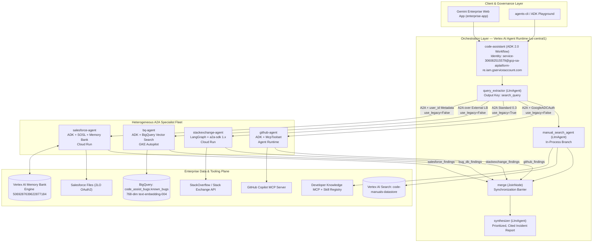
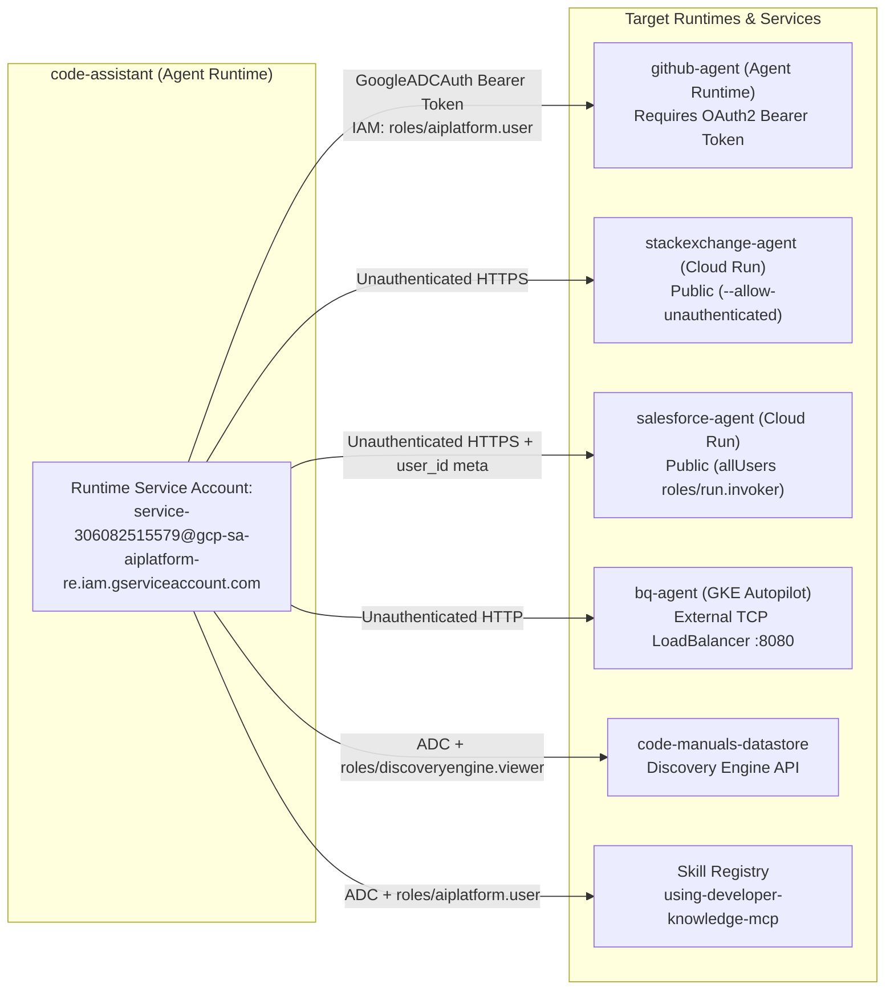

# High-Level Design (HLD) — Code Assist Heterogeneous Multi-Agent System

## 1. Architectural Vision

Modern engineering organizations rarely standardize on a single agent framework or compute platform. One team builds on **Google ADK** and deploys to **Vertex AI Agent Runtime**, another maintains an existing **LangGraph** microservice on **Cloud Run**, and a platform engineering team runs workloads on **GKE Autopilot** with **Workload Identity**.

**Code Assist** solves production-incident triage by uniting five specialized knowledge sources behind a single **ADK 2.0 `Workflow`** orchestrator (`code-assistant`), using the **Agent2Agent (A2A)** protocol as the universal interoperability layer.

---

## 2. A2A Protocol Interoperability Design

Every remote specialist exposes two standardized HTTP surfaces:
1. **Discovery Surface (Agent Card)**: A JSON document at `/.well-known/agent-card.json` (self-hosted `a2a-sdk`) or `/a2a/app/.well-known/agent-card.json` (ADK scaffold) describing capabilities, skills, input/output modes, and the JSON-RPC URL.
2. **Invocation Surface (JSON-RPC 2.0 over HTTP)**: Accepts `message/send` or streaming requests and returns structured events/artifacts.

### 2.1 Protocol Variants Handled in Code Assist

| Variant | Technical Challenge | Architectural Solution |
| :--- | :--- | :--- |
| **ADK-to-ADK vs. ADK-to-Non-ADK (`use_legacy`)** | ADK agents support the ADK A2A extension (`https://google.github.io/adk-docs/a2a/a2a-extension/`) for rich event streaming. Non-ADK servers (`stackexchange-agent` on LangGraph) only speak standard A2A. | Set `use_legacy=False` on `github_agent`, `salesforce_agent`, and `bug_db_agent`, and `use_legacy=True` (default) on `stackexchange_agent`. |
| **`a2a-sdk` 1.x Server vs. `0.3` Client** | `a2a-sdk` 1.x moved endpoint definitions into `supportedInterfaces`, whereas ADK's pinned `0.3` client inspects `0.3`-compatible interface declarations. | Configure `stackexchange-agent` (`app/server.py`) with two `AgentInterface` entries (`protocol_version="1.0"` and `protocol_version="0.3"`) and `enable_v0_3_compat=True` on `A2AStarletteApplication`. |
| **Input Payload Noise (`CleanQueryRemoteA2aAgent`)** | `RemoteA2aAgent` by default serializes prior conversation context (`For context: [query_extractor] said: ...`), which pollutes deterministic keyword/SOSL searches (`stackexchange-agent`, `salesforce-agent`). | Subclass `RemoteA2aAgent` into `CleanQueryRemoteA2aAgent` to strip conversational framing and pass only `session.state["search_query"]`. |

---

## 3. Cross-Runtime Authentication & Authorization Model

### 3.1 Downstream Specialist Credentials
- **`github-agent`**: Authenticates to `https://api.githubcopilot.com/mcp/` using `Authorization: Bearer ${GITHUB_PERSONAL_ACCESS_TOKEN}` via `StreamableHTTPConnectionParams`.
- **`bq-agent`**: Runs on GKE Autopilot under Kubernetes Service Account `bq-agent/bq-agent` federated via **GKE Workload Identity** (`roles/iam.workloadIdentityUser`) to Google Service Account `bq-agent-app@${PROJECT_ID}.iam.gserviceaccount.com`, holding `roles/bigquery.jobUser`, `roles/bigquery.dataViewer`, and `roles/aiplatform.user`.
- **`salesforce-agent`**: Authenticates to Salesforce via OAuth 2.0 `client_credentials` (2-Legged OAuth) flow against `https://${SALESFORCE_DOMAIN}/services/oauth2/token`, and connects to **Vertex AI Memory Bank** (`us-central1`) using its Cloud Run service account.

---

## 4. Long-Term Per-User Memory Architecture (Task 8)

Over unauthenticated A2A calls, a remote specialist normally lacks the end user's identity and falls back to an ephemeral session-derived ID (`A2A_USER_{context_id}`), preventing cross-session memory recall.

Code Assist solves this via a two-stage identity forwarding contract:
1. **Outbound Metadata Injection (`code-assistant`)**: `user_id_meta_provider` attaches `{"user_id": ctx.user_id}` to the A2A `SendMessageRequest` metadata.
2. **Inbound Request Conversion (`salesforce-agent`)**: `_user_scoped_request_converter` extracts `user_id` from the A2A metadata and overrides `AgentRunRequest.user_id`. Both `PreloadMemoryTool()` (pre-turn recall) and `callback_context.add_session_to_memory()` (post-turn background consolidation) operate under `{app_name: "app", user_id: <real_user_id>}` in Vertex AI Memory Bank.
