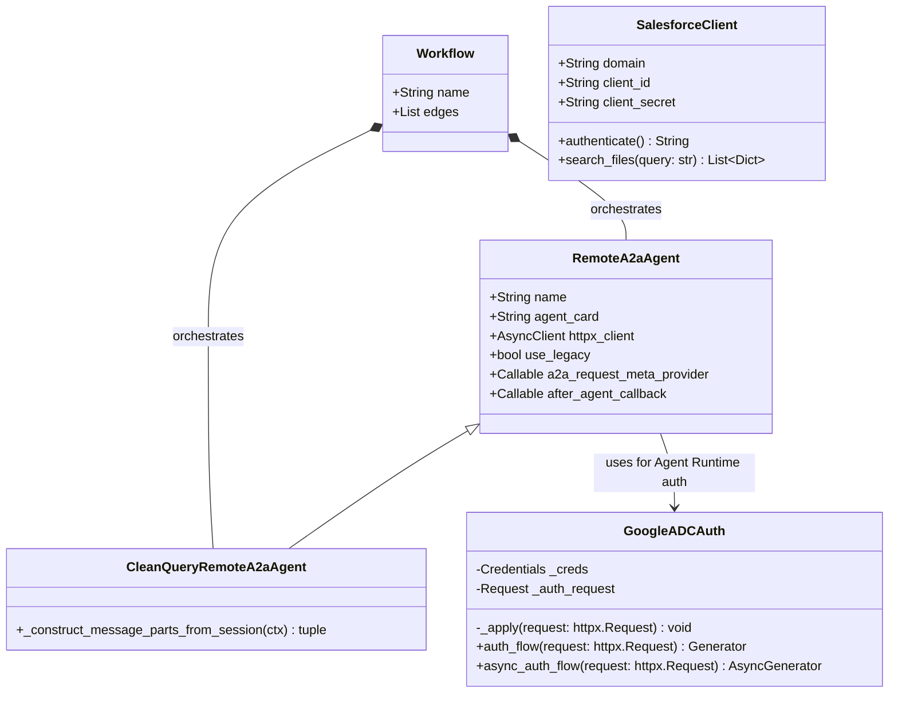

# Low-Level Design (LLD) — Code Assist Heterogeneous Multi-Agent System

## 1. Class & Module Architecture



---

## 2. Specialist-by-Specialist Low-Level Design

### 2.1 `github-agent` (`agents/github-agent/`)
- **File**: `app/agent.py`
- **Model**: `Gemini(model=os.environ["MODEL"], retry_options=types.HttpRetryOptions(attempts=3))`
- **MCP Toolset**:
  ```python
  github_mcp_toolset = McpToolset(
      connection_params=StreamableHTTPConnectionParams(
          url=GITHUB_MCP_URL,
          headers={"Authorization": f"Bearer {GITHUB_TOKEN}"},
      ),
      tool_filter=GITHUB_TOOL_FILTER,
  )
  ```
- **Filtered Tools**:
  - `search_repositories`, `search_issues`, `list_issues`, `get_issue`, `get_issue_comments`, `list_pull_requests`, `search_pull_requests`, `pull_request_read`

---

### 2.2 `stackexchange-agent` (`agents/stackexchange-agent/`)
- **Files**: `app/agent.py`, `app/server.py`
- **Graph State (`app/agent.py`)**:
  ```python
  class State(TypedDict):
      query: str
      answer: str

  workflow = StateGraph(State)
  workflow.add_node("search", search)
  workflow.add_edge(START, "search")
  workflow.add_edge("search", END)
  graph = workflow.compile()
  ```
- **Dual-Protocol A2A Card (`app/server.py`)**:
  ```python
  rpc_url = f"{PUBLIC_URL}/a2a/jsonrpc"
  agent_card = AgentCard(
      name="StackExchangeAgent",
      description="...",
      supported_interfaces=[
          AgentInterface(url=rpc_url, protocol_binding="JSONRPC", protocol_version="1.0"),
          AgentInterface(url=rpc_url, protocol_binding="JSONRPC", protocol_version="0.3"),
      ],
      version="1.0.0",
      capabilities=AgentCapabilities(streaming=False),
      default_input_modes=["text/plain"],
      default_output_modes=["text/plain"],
      skills=[skill],
  )
  a2a_app = A2AStarletteApplication(
      agent_card=agent_card,
      http_handler=request_handler,
      enable_v0_3_compat=True,
  )
  ```

---

### 2.3 `bq-agent` (`agents/bq-agent/`)
- **Files**: `app/agent.py`, `deployment/terraform/single-project/service.tf`, `deployment/terraform/single-project/variables.tf`
- **BigQuery Table Schema (`code_assist_bugs.known_bugs`)**:
  | Column | Type | Description |
  | :--- | :--- | :--- |
  | `bug_id` | `STRING` | Stable incident identifier (e.g., `BUG-1051`, `BUG-1016`) |
  | `title` | `STRING` | Short incident title |
  | `description` | `STRING` | Full incident symptom description |
  | `resolution` | `STRING` | Concrete engineering fix |
  | `description_embedding` | `ARRAY<FLOAT64>` | 768-dim embedding produced by `text-embedding-004` |
- **Tool Implementation (`find_similar_bugs(query: str) -> str`)**:
  1. **Query Embedding**: Calls `genai.Client(vertexai=True, project=project, location="us-central1").models.embed_content(model="text-embedding-004", contents=query)` to generate a 768-float vector.
  2. **Vector Search SQL**:
     ```sql
     SELECT
       base.bug_id,
       base.title,
       base.description,
       base.resolution,
       distance
     FROM VECTOR_SEARCH(
       TABLE `qwiklabs-gcp-01-da944a54194d.code_assist_bugs.known_bugs`,
       'description_embedding',
       (SELECT @query_embedding AS embedding),
       query_column_to_search => 'embedding',
       top_k => 3,
       distance_type => 'COSINE'
     )
     ORDER BY distance ASC
     ```
  3. **Query Parameter Binding**: `bigquery.ArrayQueryParameter("query_embedding", "FLOAT64", vector)`.
- **Terraform GKE Modifications**:
  - `service.tf`: Removed `networking.gke.io/load-balancer-type = "Internal"` from `kubernetes_service_v1.app` so GKE provisions an external LoadBalancer IP (`23.236.62.247:8080`), and added `GOOGLE_GENAI_USE_VERTEXAI = "True"` and `MODEL = "gemini-3.5-flash"` to the container `env` block.
  - `variables.tf`: Added `"roles/bigquery.jobUser"` and `"roles/bigquery.dataViewer"` to `app_sa_roles`.

---

### 2.4 `code-assistant` Root Orchestrator (`agents/code-assistant/`)
- **Files**: `app/callbacks.py`, `app/auth.py`, `app/app_utils/a2a.py`, `app/agent.py`
- **State Capture Callback (`app/callbacks.py`)**:
  ```python
  def capture_response_to_state(state_key: str):
      def _after_agent_callback(callback_context: CallbackContext) -> types.Content | None:
          events = callback_context.session.events
          for event in reversed(events):
              if event.author == callback_context.agent_name and event.content and event.content.parts:
                  text_parts = [p.text for p in event.content.parts if p.text]
                  if text_parts:
                      callback_context.state[state_key] = "\n".join(text_parts)
                      break
          return None
      return _after_agent_callback
  ```
- **Google ADC HTTPX Auth (`app/auth.py`)**:
  ```python
  def _apply(self, request: httpx.Request) -> None:
      headers: dict[str, str] = {}
      self._creds.before_request(
          self._auth_request, request.method, str(request.url), headers
      )
      request.headers.update(headers)
  ```
- **User ID Metadata Provider (`app/app_utils/a2a.py`)**:
  ```python
  def user_id_meta_provider(ctx: InvocationContext, _message: A2AMessage) -> dict[str, Any]:
      return {"user_id": ctx.user_id}
  ```

---

### 2.5 `salesforce-agent` & Memory Bank (`agents/salesforce-agent/`)
- **Files**: `app/salesforce_client.py`, `app/app_utils/a2a.py`, `app/agent.py`, `scripts/create_memory_bank.py`
- **2-Legged OAuth (`app/salesforce_client.py`)**:
  ```python
  response = httpx.post(
      f"https://{self.domain}/services/oauth2/token",
      data={
          "grant_type": "client_credentials",
          "client_id": self.client_id,
          "client_secret": self.client_secret,
      },
      timeout=_TIMEOUT_SECONDS,
  )
  ```
- **User-Scoped Request Converter (`app/app_utils/a2a.py`)**:
  ```python
  run_request = convert_a2a_request_to_agent_run_request(
      request, part_converter=part_converter
  )
  ```
- **Idempotent Memory Bank Provisioning (`scripts/create_memory_bank.py`)**:
  ```python
  client = vertexai.Client(project=PROJECT_ID, location=LOCATION)
  engine = next(
      (
          e for e in client.agent_engines.list()
          if getattr(e.api_resource, "display_name", None) == DISPLAY_NAME
      ),
      None,
  )
  if engine is None:
      engine = client.agent_engines.create(config={"display_name": DISPLAY_NAME})
  engine_id = engine.api_resource.name.split("/")[-1]
  ```
