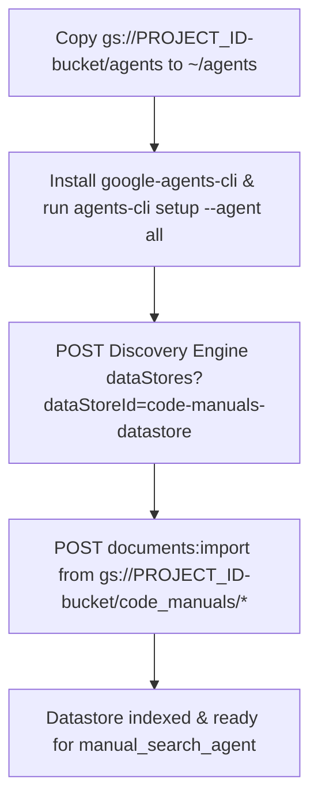
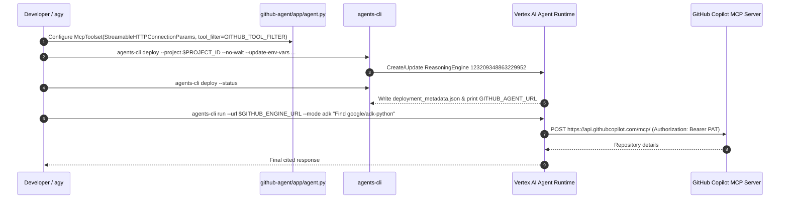
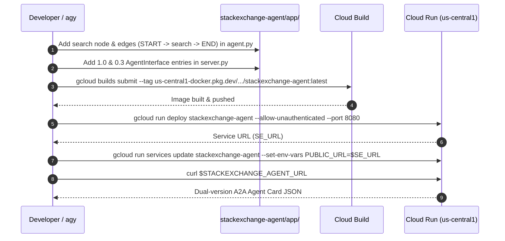
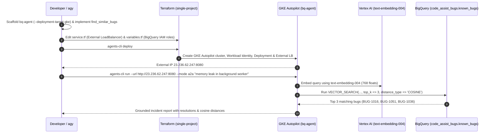
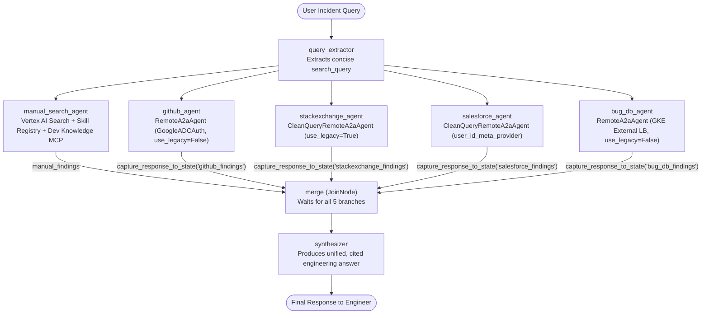
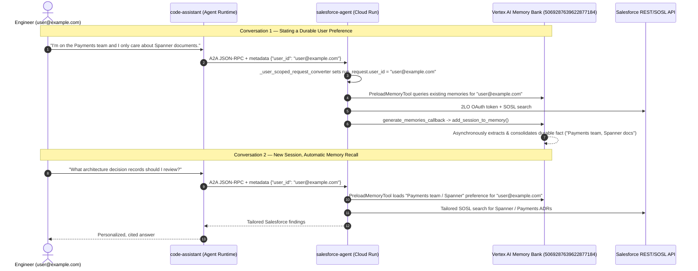

# Step-by-Step Workflows — Code Assist Heterogeneous Multi-Agent Lab

## Overview of the 8-Task Progression

```mermaid
flowchart LR
    T1["Task 1<br/>Setup & Vertex AI Search<br/>(code-manuals-datastore)"] --> T2["Task 2<br/>github-agent<br/>(ADK + MCP on Agent Runtime)"]
    T2 --> T3["Task 3<br/>stackexchange-agent<br/>(LangGraph + a2a-sdk on Cloud Run)"]
    T3 --> T4["Task 4<br/>bq-agent<br/>(ADK + BigQuery Vector Search on GKE)"]
    T4 --> T5["Task 5<br/>code-assistant Workflow<br/>(Fan-out + JoinNode + Skill Registry)"]
    T5 --> T6["Task 6<br/>Deploy Root & IAM<br/>(Agent Runtime + Gemini Enterprise)"]
    T6 --> T7["Task 7<br/>salesforce-agent<br/>(2LO OAuth + SOSL on Cloud Run)"]
    T7 --> T8["Task 8<br/>Vertex AI Memory Bank<br/>(Per-User Long-Term Memory)"]
```

---

## Task 1: Environment & Vertex AI Search Datastore (`code-manuals-datastore`)

---

## Task 2: `github-agent` on Vertex AI Agent Runtime

---

## Task 3: `stackexchange-agent` (LangGraph + `a2a-sdk`) on Cloud Run

---

## Task 4: `bq-agent` (ADK + BigQuery `VECTOR_SEARCH`) on GKE Autopilot

---

## Tasks 5 & 6: `code-assistant` Root Graph Workflow & Agent Runtime Deployment

---

## Tasks 7 & 8: `salesforce-agent` & Per-User Long-Term Memory on Vertex AI Memory Bank

